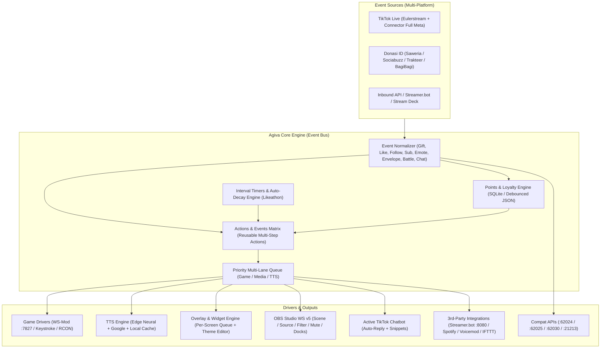

# Analisa Perbandingan TikFinity vs `agiva-mod` & Rancangan Optimalisasi

> **Tanggal Analisa:** 19 November 2026  
> **Target Referensi:** [TikFinity | TikTok LIVE Tools](https://tikfinity.com/app/) (Web App & Desktop App v1.7.0)  
> **Proyek Lokal:** `agiva-mod` (`tiktok-live-bridge` v1.3.1 — Electron + Node.js Express/WS)

---

## 1. Ringkasan Eksekutif

**`agiva-mod`** sudah memiliki fondasi arsitektur yang sangat kuat dan bahkan memiliki beberapa **keunggulan unik** dibanding TikFinity—khususnya di ranah **modding game langsung (Unity BepInEx WS, Win32 SendInput ScanCode, RCON/ServerTap)**, **integrasi donasi lokal Indonesia (Saweria/Sociabuzz/Trakteer/BagiBagi + kurs IDR-ke-Koin)**, **kompatibilitas port IndoFinity (`:62024/:62025/:62030`)**, serta **100% lokal & gratis tanpa batasan PRO**.

Namun, berdasarkan inspeksi langsung pada antarmuka `https://tikfinity.com/app/` dan audit kode sumber `agiva-mod`, ditemukan dua kelompok besar pekerjaan:

1. **Gap Fitur (Belum Ada di `agiva-mod`):** Sistem Points/Level & Loyalty, Active TikTok Chatbot & Timed Actions, Spotify Song Requests, Likeathon (auto-decay), 20+ Overlay Interaktif & Mini-Games (Last X, Gift Battle, Coin Match, Coin Jar, Gift Firework/Cannon, Emojify, Like Fountain, Stream Buddies, Chat/Gift Feed, Interaction Slider, Countdown & Custom Goals, OBS Docks, Graphic Packs), event TikTok lanjutan (`subscribe`, `emote`, `envelope`, `battle`), serta integrasi pihak ketiga (Streamer.bot, Voicemod, Stream Deck, IFTTT, Event API `:21213`).
2. **Belum Optimal / Bug Sinkronisasi Kode (Sudah Ada tetapi Patah atau Terbatas):** Audit mendalam pada `src/` dan `public/` menemukan **9+ ketidaksesuaian kontrak (contract mismatch) antara Frontend (`app.js`/`index.html`) dan Backend (`server.js`, `audioTtsDriver.js`, `effectMap.js`, `obsDriver.js`, `donationSocketProvider.js`, `sessionStore.js`, `overlay.js`)** yang membuat sebagian fitur yang sudah ada di UI tidak berjalan sebagaimana mestinya, ditambah bottleneck performa I/O sinkron dan DOM rendering.

---

## 2. Matriks Perbandingan Fitur (TikFinity vs `agiva-mod`)

| Kategori | Fitur di TikFinity (`tikfinity.com/app`) | Status di `agiva-mod` v1.3.1 | Keterangan / Gap |
| :--- | :--- | :--- | :--- |
| **Koneksi TikTok** | Web (`@handle`) & Desktop local login | **Ada (Perlu Optimasi)** | Eulerstream WS + `tiktok-live-connector` Hybrid + Electron Login; namun metadata user terpotong di mode Eulerstream. |
| **Event TikTok** | Gift, Like, Follow, Share, Join, Chat, **Subscribe/SuperFan, Emote, Envelope, Battle, LiveStatus** | **Parsial** | Belum menangani `subscribe`, `emote`, `envelope`, `questionNew`, `linkMicBattle`, `liveStatusChange`. |
| **Actions & Events** | Matriks terpisah (1 Action reusable ↔ banyak Event), multi-screen queue, Import/Export | **Parsial (Terbatas)** | Mapping langsung ke 1 Game Effect + `chainActions` parsial (banyak field backend tidak diekspos di UI). |
| **TTS (Text-to-Speech)** | AI/Neural Voices, Random Voice, Pitch/Speed/Vol, Role/Special Users, Charge Points, Max Queue, Content Filter, TTS Logs | **Ada (Banyak Bug Sinkronisasi)** | Hanya Google Translate TTS (limit 200 char); payload UI tidak cocok dengan backend; belum ada Neural Voice, Max Queue, & Logs. |
| **Sound Alerts / Board** | Sound Alerts per-event, Search, Volume, Upload, Hotkey | **Ada (Bug Upload & Playback)** | Upload gagal (field name beda), playback dashboard beda nama event WS, hotkey soundboard tidak terdaftar, file leak saat hapus. |
| **Overlays & Widgets** | 30+ Overlay (Goals, Countdown Goals, Custom Goals 1–3, Last X, Gift Battle, Coin Match, Coin Jar, Gift Firework/Cannon, Like Fountain, Emojify, Stream Buddies, Chat/Gift Feed, Interaction Slider, Top Gift/Streak, Gift Counter, Graphic Packs, OBS Docks) | **Parsial (7 Widget Dasar)** | Punya Timer, Wheel, Goal (hanya coins di UI), Win/Lose, Leaderboard (gifter saja), Poll, Giveaway, Multi-Screen 1–5; beberapa URL copy patah (`winlose`, `all`). |
| **Points & Loyalty** | Points/Level DB, Sub Bonus %, Transactions, `!score`, `!transfer`, Points Drop (`!get`), Challenge, Halving | **Belum Ada** | Belum ada sistem ekonomi penonton / loyalty database. |
| **Chat & Chatbot** | Built-in commands, Custom commands, Active Chatbot auto-reply, Spam protection, Snippets | **Parsial (Trigger Saja)** | Baru mendukung *membaca* chat command untuk trigger efek (dan role filter patah); belum bisa *membalas* ke chat TikTok. |
| **Interval Timers** | Periodic Actions saat Live (tiap X menit) | **Belum Ada** | Baru ada Subathon Countdown Timer, belum ada scheduler aksi berkala. |
| **Song Requests** | Spotify (`!play`, `!skip`, `!revoke`), queue limit, explicit filter, overlay Now Playing | **Belum Ada** | Belum ada integrasi musik / Spotify. |
| **Tools & Mini-Games** | Likeathon (auto-decay), Wheel of Fortune (`!spin` + 24 slot + gamble), Penalty Battle | **Parsial** | Punya Spin Wheel dasar (tanpa `!spin`/gamble/weight UI) & Giveaway; belum ada Likeathon & Penalty Battle. |
| **OBS Studio** | WS v5: Switch Scene, Activate/Deactivate Source, OBS Docks | **Ada (Belum Optimal)** | Punya Switch Scene, Filter, Mute di backend, tapi badge UI selalu `DISCONNECTED`, belum ada Source Visibility, & tanpa auto-reconnect. |
| **Integrasi Game** | Minecraft (Fabric / ServerTap), Keystroke PC (Roblox, GTA V) | **Unggul di `agiva-mod`** | Sudah punya Unity BepInEx WS Mod (`:7827`), Win32 `SendInput` + AutoIt, RCON TCP + ServerTap HTTP, & 7 game manifest modular. |
| **Integrasi Pihak Ketiga** | Streamer.bot (`:8080`), Voicemod, Stream Deck, IFTTT, Event API (`:21213`), Mobile App | **Parsial** | Punya Outgoing Webhook & IndoFinity Compat Ports (`:62024/:62025/:62030`); belum ada Streamer.bot, Voicemod, IFTTT, `:21213`, Mobile Companion. |
| **Donasi Indonesia** | Tidak tersedia native | **Unggul di `agiva-mod`** | Saweria, Sociabuzz, Trakteer, BagiBagi + kurs IDR-ke-Koin (namun payload UI Saweria saat ini patah). |

---

## 3. Hasil Analisa Bagian A: Fitur TikFinity yang BELUM ADA di `agiva-mod`

### 3.1. Event TikTok LIVE yang Belum Didukung
Saat ini `src/server.js` hanya memproses `gift`, `like`, `follow`, `share`, `repost`, `member`, `chat`, dan `roomUser`. Event penting berikut belum ditangkap:
- **Subscribe / Super Fan (`WebcastSubNotifyMessage` / `subscribe`)**: Trigger khusus pelanggan baru/perpanjangan & multiplier bonus.
- **Subscriber Emotes (`WebcastEmoteChatMessage` / `emote`)**: Untuk animasi *Emojify* atau trigger khusus emote subscriber.
- **Treasure Box / Chest (`WebcastEnvelopeMessage` / `envelope`)**: Notifikasi saat penonton mengirim peti koin.
- **Q&A (`WebcastQuestionNewMessage`)**: Menampilkan pertanyaan penonton di layar.
- **PK Battle (`WebcastLinkMicBattle` / `WebcastLinkMicArmies`)**: Trigger efek game/overlay otomatis saat PK dimulai, skor berubah, atau menang/kalah PK.
- **Live Status Change (`liveStatusChange`)**: Otomatis mulai/reset sesi analytics, jalankan aksi pembuka/penutup live, atau kirim notifikasi Discord/Webhook.

### 3.2. Sistem Points, Levels & Loyalty Penonton
Salah satu pilar retensi terbesar di TikFinity yang belum dimiliki `agiva-mod`:
- **Database User & Points** (tanpa batas 2.500 user seperti versi gratis TikFinity) untuk mencatat poin, XP, level (kurva eksponensial), total koin, total like, dan menit menonton/chat.
- **Subscriber Bonus Multiplier (%)**: Bonus poin otomatis bagi subscriber/superfan.
- **Transactions Ledger**: Log audit setiap transaksi poin (earn/spend/transfer/gamble).
- **Chat Commands Ekonomi**: `!score` / `!points`, `!transfer @user [jumlah]`, `!gamble [jumlah]`, `!spin` (bayar poin), `!help` / `!commands`.
- **Points Drop (`!get`)**: Event drop koin berkala (manual / auto-interval) agar penonton berebut mengetik `!get` di chat.
- **Challenge & Halving Tools**: Reset poin sementara untuk event/turnamen (lalu gabung atau buang hasilnya) dan *Halving* (potong % poin semua user tanpa mereset level).

### 3.3. Active TikTok Chatbot & Interval Actions Scheduler
- **Active Chatbot (Auto-Reply)**: Mengirim balasan otomatis ke kolom chat TikTok menggunakan sesi lokal Desktop App, lengkap dengan *Spam Protection* (batas pesan per 15 detik) dan *Snippet Templates* (`{user}`, `{points}`, `{level}`, `{command}`).
- **Interval / Periodic Timers**: Menjalankan Action secara berkala setiap $N$ menit selama live berlangsung (misalnya rotasi pengingat follow/saweria, atau trigger random chaos setiap 5 menit).

### 3.4. Katalog Overlay & Mini-Games Interaktif (Peluang Mengalahkan TikFinity PRO Secara Gratis)
Banyak fitur terpopuler TikFinity berada di balik paywall **PRO**—`agiva-mod` dapat menghadirkannya secara **100% gratis & lokal**:

1. **Last X Overlays**: `Last Follower`, `Last Gifter`, `Last Subscriber`, `Last Share`, `Last Like`, `Last Chatter`.
2. **Gift Overlays Spesifik**:
   - `Top Gift` (1 gift termahal pada sesi ini) & `Top Streak` (combo gift terbanyak).
   - `Gift Counter` (hingga 3 slot counter untuk gift tertentu, opsional target).
   - `Gift Battle` (balapan 2 gift menuju target—memicu efek berbeda untuk pemenang Kiri vs Kanan).
   - `Gift Firework` & `Gift Cannon` (avatar penonton + ikon gift meledak/terbang di layar).
3. **Interactive Engagement Overlays**:
   - `Coin Match` (lelang koin/gift berbatas waktu dengan tombol Start/End/Reset/Show Winners).
   - `Coin Jar` (toples fisik 2D/physics yang terisi koin/ikon gift setiap ada gift masuk).
   - `Like Fountain` (partikel hati melayang saat penonton tap-tap layar).
   - `Emojify` (emoji chat & sub-emote muncul melayang di layar).
   - `Stream Buddies` (karakter/avatar top gifter berjalan di bawah layar + gelembung chat).
   - `Interaction Slider` (banner berjalan menampilkan daftar gift & efek game yang bisa dipicu penonton—sangat krusial untuk menaikkan konversi gift!).
   - `Chat Box Overlay` & `Gift Feed Overlay` (terpisah untuk OBS, lebar ~400px).
   - `Viewer Count` & `Follower Count` standalone (dengan milestone action).
   - `Social Media Rotator` & `Seasonal FX` (seperti *Falling Snow*).
   - `Penalty Battle` (mini-game adu penalti berbasis gift & kiper dari chat).
4. **Goal Overlays Lengkap**:
   - Tambah `Shares`, `Viewer Count`, `Channel Points`, `New Subscribers`, **Countdown Goal Overlays** (goal dengan deadline waktu), dan **Custom Goals 1–3** yang dikontrol dari Action.
5. **Graphic Theme Packs & OBS Custom Docks**:
   - Paket bingkai Webcam Frame, Header/Footer, dan Talking Banner (tema Neon, Pixel, Cyber, Kawaii, Minimalis).
   - Halaman khusus **OBS Custom Docks** (`Dock 1` / `Dock 2`) agar streamer bisa memantau feed & menekan quick-trigger langsung di dalam jendela OBS Studio.

### 3.5. Spotify / Music Song Requests
- Koneksi Spotify OAuth / lokal dengan command `!play [Judul - Artis]`, `!skip`, `!revoke`.
- Pengaturan biaya poin/koin, filter *Explicit Content*, batas antrean global & per-user, riwayat lagu, serta overlay *Now Playing & Queue*.

### 3.6. Tools & Integrasi Ekosistem Eksternal
- **Likeathon**: Leaderboard Top Liker kompetitif dengan *Automatic Reduction / Decay* (misal skor berkurang 10% tiap 10 detik) agar penonton terus tap layar untuk mempertahankan posisi #1.
- **Streamer.bot Integration**: Koneksi WebSocket (`127.0.0.1:8080`) untuk memicu Streamer.bot Action dengan 14+ placeholder variable (`%userId%`, `%username%`, `%nickname%`, `%profilePictureUrl%`, `%giftId%`, `%giftName%`, `%coins%`, `%repeatCount%`, `%likeCount%`, dll.) serta menerima push command dari Streamer.bot.
- **Voicemod Integration**: Mengubah filter suara mikrofon streamer sementara saat menerima gift tertentu.
- **Elgato Stream Deck & IFTTT / Smart Home**: Endpoint aksi + paket ikon Stream Deck, dan preset Webhook IFTTT/Home Assistant (misal kedipkan lampu RGB saat gift besar).
- **TikFinity-Compatible Event API (`ws://localhost:21213/`)**: Menyediakan port standar `21213` berformat `{ "event": "...", "data": { ... } }` agar plugin/overlay komunitas TikFinity langsung kompatibel dengan `agiva-mod`.
- **Mobile Companion / LAN Remote**: Akses dashboard ringan + pemutar Sound Alerts & TTS melalui browser HP di jaringan Wi-Fi lokal (melalui QR Code di Dashboard) untuk streamer *mobile-only* atau kontrol jarak jauh.

---

## 4. Hasil Analisa Bagian B: Fitur `agiva-mod` yang BELUM OPTIMAL / BERMASALAH

Audit kode langsung terhadap `src/` dan `public/` menemukan banyak fitur yang **secara konsep sudah dibangun**, tetapi mengalami *contract mismatch* antara UI dan Backend, bottleneck performa, atau belum tuntas diekspos.

### 4.1. Temuan Kritis: Contract Mismatch Frontend vs Backend (Fitur Patah Diam-Diam)

| No | Area | Lokasi Kode | Akar Masalah (Temuan Audit) | Dampak ke Pengguna |
| :-: | :--- | :--- | :--- | :--- |
| **1** | **TTS Config & Template** | `public/dashboard/app.js` (L1740–1758) vs `src/drivers/audioTtsDriver.js` (L10–31, L255–356) | UI mengirim `lang`, `volume` (0–100), `speed`, `specificUsers` (array), `minGifterCoins`, `userCooldownSec`, `commentTriggerMode: 'prefix'`, `commentPrefix`, `readChat`, dan template `{gift}`/`{repeat}`. Backend membaca `voicePreset`, `volume` (0–1), `rate`, `allowedUsers` (string), `minGifterLevel`, `cooldownSec`, `chatMode: 'command'`, `chatCommand`, dan template `{giftname}`/`{repeatcount}`. | Hampir semua pengaturan di tab TTS (bahasa Jawa/Sunda/Melayu, slider volume/speed, whitelist user, prefix, cooldown, template gift) **tidak berefek** atau salah skala. |
| **2** | **Upload & Playback Soundboard** | `app.js` (L89–95, L1798–1803) vs `audioTtsDriver.js` (L367, L381, L387) | Upload mengirim `{ fileName, base64Data }`, backend butuh `{ filename, dataBase64 }`. Playback WS backend mengirim `type: 'sound_play'` (field `file`) & `audio_stop_all`, sedangkan Dashboard mendengarkan `soundboard_play` (field `url`) & `tts_skip`/`audio_stop`. | **Upload MP3/WAV selalu gagal (HTTP 400)**; suara soundboard & tombol skip tidak sinkron di Dashboard. |
| **3** | **Chat Role Filter & Kolom Tabel** | `app.js` (L1046–1104, L1299–1306) vs `src/effectMap.js` (L145–172) & `index.html` (L293–354) | `collectChatCmdData()` menyimpan `requiredRole` & `specificUsers` (array), sedangkan `checkUserPermission()` mengecek `allowedRole` & `allowedUsers` (string). Selain itu `gift-table` punya 9 `<th>` tapi hanya 8 `<td>` (kolom Role hilang), dan `chatcmd-table` punya 9 `<th>` tapi 7 `<td>`. | **Filter Role & Specific Users pada Chat Command tidak bekerja**, dan kolom tabel Configurator bergeser. |
| **4** | **URL Overlay Widget Patah** | `public/dashboard/index.html` (L761–766) vs `public/overlay/overlay.js` (L8–11, L171–203) | Tombol salin menghasilkan `/overlay?widget=winlose`, `/overlay?widget=all`, dan `/overlay?widget=goal`. Padahal `overlay.js` hanya mengenali `widget=counter`, tidak punya mode `all`, dan `goal` default ke `likes` (sementara UI hanya mengatur goal `coins`). | URL Win/Lose & Semua Widget tampil **kosong**, URL Goal salah melacak Likes alih-alih Coins. |
| **5** | **OBS Status Badge** | `app.js` (L2015, L2025) vs `src/drivers/obsDriver.js` (L54) | Backend mengembalikan `{ isConnected: true }`, UI mengecek `st.connected`. | Badge OBS selalu menampilkan **`DISCONNECTED`** meski sudah terhubung. |
| **6** | **Saweria Direct Socket** | `app.js` (L1988–1995, L2059–2066) vs `src/providers/donationSocketProvider.js` (L52–74) | UI mengirim `{ idrPerCoin, saweria: { enabled, streamKey } }` dan membaca `don.config.saweria`. Backend mewajibkan `{ platforms: { saweria: ... } }` dan mengembalikan objek langsung tanpa wrapper `.config`. | **Menyimpan Stream Key Saweria dari UI tidak tersimpan dan socket tidak pernah konek.** |
| **7** | **Analytics Donasi & Peak Viewers** | `app.js` (L2081–2083) vs `src/storage/sessionStore.js` (L25, L129–141) | Backend menyimpan `totals.donationsIdr`, UI membaca `totals.donationIdr` (kurang huruf `s`). `sessionStore` juga tidak pernah mencatat `peakViewers`. | Total Donasi di Analytics selalu **Rp 0** dan Peak Viewers hanya menampilkan viewers saat ini. |
| **8** | **Filter Log Live Events** | `index.html` (L437–443) vs `app.js` (L1444–1475) | Checkbox `#filter-gift`, `#filter-follow`, `#filter-member`, `#filter-like`, `#filter-chat`, `#filter-donation` tidak memiliki event listener. | Mencentang/menghapus centang filter di tab Live Events **tidak memfilter tabel**. |
| **9** | **Eulerstream User Metadata Stripped** | `src/server.js` (L678–697) | Pada event Chat, Like, Social, Member via Eulerstream WS, handler hanya meneruskan `{ uniqueId: msg.data.user?.uniqueId }` dan membuang seluruh objek `msg.data.user` (`nickname`, `followInfo`, `isSubscribe`, `userAttr`, `badgeList`, `avatar`). | Di mode default (Eulerstream), **Role Filtering & `{nickname}` gagal total** untuk chat/like/follow/share. |

### 4.2. Kelemahan Performa, Stabilitas & Arsitektur Backend

1. **Synchronous File I/O pada Hot Path (`widgetManager.js`, `sessionStore.js`)**:
   - Setiap gift atau setiap 100 like memicu `controlTimer('add')` → `saveConfig()` → `fs.writeFileSync(...)` secara sinkron di event loop utama. Pada live ramai, ini menyebabkan *event loop lag* dan keterlambatan keystroke/WS.
   - Sebaliknya, `sessionStore.recordLike()`, `recordFollow()`, `recordChat()` tidak pernah disimpan ke disk sampai ada gift masuk (data hilang jika aplikasi ditutup).
2. **Queue Settings Tidak Hot-Reload & Antrean Tunggal (`src/server.js` L46, L1043; `src/queue.js`)**:
   - Mengubah `maxQueueSize`, `minDelayBetweenEffects`, atau `dropOnFull` di Settings tidak memperbarui instance `queue` aktif sampai restart.
   - Semua driver (`ws-mod`, `keystroke`, `rcon`) berbagi satu antrean serial tanpa *priority tier* (gift besar 1.000 koin bisa tertahan oleh antrean like/chat murah).
3. **Tidak Ada Auto-Reconnect pada OBS & Saweria (`obsDriver.js`, `donationSocketProvider.js`)**:
   - Jika OBS Studio di-restart atau WebSocket Saweria terputus karena gangguan jaringan, koneksi mati permanen hingga user klik manual.
   - `sociabuzz`, `trakteer`, dan `bagibagi` di `donationSocketProvider.js` baru menampilkan status dummy `'ready (stream-key + webhook)'` tanpa koneksi real-time socket.
4. **Kebocoran File Audio & Hotkey Tidak Sinkron (`audioTtsDriver.js`, `server.js`, `index.html`)**:
   - `deleteSound()` tidak menghapus file fisik di `public/sounds/`, menyebabkan akumulasi file sampah.
   - Hotkey soundboard (`Alt+5`..`Alt+8`) tidak pernah didaftarkan ke Electron `globalShortcut`.
   - Teks bantuan hotkey di `index.html` L975 (`Alt+Shift+P/S/W/H`) tidak sesuai dengan kode `server.js` L172–178 (`Alt+P/C/S/L/1/2`), dan belum ada UI untuk mengubah hotkey meski endpoint `POST /api/desktop/hotkeys` sudah tersedia.
5. **Keterbatasan TTS Engine (`audioTtsDriver.js`, `overlay.js`)**:
   - Google Translate TTS memotong kalimat >200 karakter tanpa memecah kalimat (*sentence chunking*), hanya punya 1 warna suara per bahasa, tanpa caching audio lokal, dan tanpa `maxQueueLength` (rawan antrean TTS menumpuk berjam-jam saat chat spam).

### 4.3. Kelemahan Optimalisasi UI/UX & Fitur Eksisting

1. **DOM Bloat di Configurator (`app.js` L979–997)**:
   - `buildGiftSelect()` menyisipkan **seluruh daftar gift** (`gifts-data.json`) lengkap dengan tag `` di **setiap baris** tabel *Specific Gift Mapping*. Jika katalog berisi 300+ gift dan ada 20 baris mapping, browser merender **6.000+ elemen DOM & gambar sekaligus** → tab Configurator berat/lag.
2. **Fitur Multi-Action Chaining Backend Tersembunyi di UI (`server.js` L322–350 vs `app.js` L935–957)**:
   - Backend `executeChainedActions()` sudah mendukung `ttsTemplate`, `overlayMediaUrl`, `timerAddSec`, `obsScene`, `obsDurationSec`—tetapi UI hanya menampilkan `soundId`, `overlayScreen`, dan `spinWheel`.
3. **Overlay Tanpa Kustomisasi Tampilan & Tanpa Queue Per-Screen (`overlay.js` L140)**:
   - `showScreenAlert()` langsung menghapus alert sebelumnya (`screenStage.innerHTML = ''`) tanpa antrean per-screen (`maxQueueLength`).
   - Belum ada pengaturan tema visual per-widget (Font, Warna, Ukuran, Opacity, Posisi, Animasi, Custom CSS) seperti drawer *Look* di TikFinity.
4. **Kontrol Widget Belum Lengkap di Dashboard**:
   - **Subathon Timer**: UI hanya mengatur `secPerCoin`, padahal backend mendukung `secPer100Likes`, `secPerFollow`, `secPer10kIdr`. Belum ada *Boost Multiplier*, *Random Time*, dan *End Action*.
   - **Goal Bar**: UI hanya mengedit goal `coins`, sementara goal `likes`, `followers`, `donations`, `autoScale`, dan `rewardEffectId` tidak bisa diatur dari UI.
   - **Spin Wheel**: UI memakai `<textarea>` mentah tanpa field bobot probabilitas (`weight`), tanpa fitur auto-trigger toggle, dan tanpa preview langsung.
   - **OBS Actions**: Belum ada tombol ambil daftar Scene/Source/Filter OBS sebagai dropdown dan belum mendukung `SetSceneItemEnabled` (show/hide source OBS).

---

## 5. Rancangan Arsitektur & Roadmap Pengembangan

### 5.1. Target Arsitektur Modular (`agiva-mod` v2.0)



---

### 5.2. Roadmap Bertahap (Prioritas Eksekusi)

#### Fase 1 — Stabilisasi, Bugfix & Optimalisasi Kritis (Minggu 1–2)
*Fokus: Memastikan 100% fitur yang sudah ada di UI benar-benar berfungsi, cepat, dan stabil.*

1. **Penyelarasan Kontrak API & Payload (9 Bug Kritis)**:
   - Satukan skema `tts-sound-config.json` antara `app.js` dan `audioTtsDriver.js` (`lang`, `voicePreset`, `volume` 0–100 dinormalisasi di satu tempat, `rate`, `pitch`, `chatMode`, `chatCommand`, `allowedRole`, `allowedUsers`, `cooldownSec`, `maxQueueLength`), dan dukung alias template `{gift}`/`{giftname}` serta `{repeat}`/`{repeatcount}`.
   - Perbaiki upload soundboard (`filename`/`dataBase64`), samakan event WS (`sound_play` + `audio_stop_all`), dan tambahkan `fs.unlinkSync()` saat menghapus file suara custom.
   - Samakan field Role Filter (`allowedRole`, `allowedUsers`, `minGifterLevel`) antara `app.js` dan `effectMap.js`, serta perbaiki jumlah kolom `gift-table` & `chatcmd-table`.
   - Perbaiki `overlay.js` agar mendukung alias `?widget=winlose`, mode `?widget=all` (grid/HUD semua widget), dan `?widget=goal&type=coins|likes|followers|donations`.
   - Perbaiki status badge OBS (`isConnected`), payload Saweria (`platforms.saweria`), field analytics (`donationsIdr` + catat `peakViewers` di `handleRoomUser`), dan wiring checkbox filter di tab Live Events.
2. **Perbaikan Metadata Eulerstream (`src/server.js`)**:
   - Teruskan objek `msg.data` secara utuh (termasuk `user`, `nickname`, `followInfo`, `isSubscribe`, `userAttr`, `badgeList`, `profilePictureUrl`) pada semua handler Eulerstream.
3. **Optimalisasi Performa & Reliabilitas**:
   - Ubah `saveConfig()` di `widgetManager.js` dan `saveAtomic()` di `sessionStore.js` menjadi **debounced async persistence** (flush otomatis tiap 3 detik + `beforeExit` hook).
   - Terapkan **hot-reload** `queue.updateSettings(...)` saat `PUT /api/config` dipanggil.
   - Tambahkan **exponential backoff auto-reconnect** di `obsDriver.js` dan `donationSocketProvider.js`.
   - Ganti dropdown gift per-baris (`buildGiftSelect`) dengan **1 Modal Gift Picker terpusat** dengan pencarian real-time & lazy-loaded images (menghilangkan lag DOM).
   - Daftarkan hotkey soundboard + tambahkan UI kustomisasi Global Hotkeys di tab Settings/Integrations.

---

#### Fase 2 — Upgrade Engine Inti & Paritas Fungsional (Minggu 3–5)
*Fokus: Menyamai fleksibilitas Actions, TTS, OBS, dan Kustomisasi Overlay milik TikFinity.*

1. **Reusable Actions & Events Matrix (`src/core/actionEngine.js`)**:
   - Pisahkan entitas **Action** (kumpulan langkah berurutan: `gameEffect`, `playSound`, `speakTts`, `showScreenAlert`, `obsAction`, `timerAdd`, `spinWheel`, `customGoal`, `webhook`, `delayMs`) dari entitas **Event Trigger**.
   - Dukung event TikTok baru: `subscribe` / SuperFan, `emote`, `envelope`, `questionNew`, `linkMicBattle`, `liveStatusChange`.
   - Sediakan Modal Action Builder yang mengekspos semua capability backend (termasuk `overlayMediaUrl` dengan upload lokal GIF/MP4/WebM, `obsScene`/`obsSource`/`obsFilter`, `ttsTemplate`, `timerAddSec`).
   - Tambahkan **Priority Multi-Lane Queue** (lane terpisah untuk Game Mod, Keystroke, RCON, dan Media/Alert; prioritas tinggi untuk gift mahal/donasi).
2. **Upgrade TTS Engine (`src/drivers/edgeTtsProvider.js`)**:
   - Tambahkan **Microsoft Edge Neural TTS gratis** (suara Indonesia natural seperti `id-ID-GadisNeural`, `id-ID-ArdiNeural`, plus 100+ bahasa & mode *Random Voice*), dengan fallback otomatis ke Google TTS → Web Speech API.
   - Tambahkan *sentence chunking* untuk teks >200 karakter, cache MP3 LRU lokal, `maxQueueLength`, serta panel **TTS Logs & Skip Queue** di Dashboard.
3. **Overlay Theme Customizer & Per-Screen Queue**:
   - Tambahkan antrean terpisah di `overlay.js` untuk setiap Screen (`screen=1..10`) dengan pengaturan `maxQueueLength` dan posisi.
   - Tambahkan panel **Customize Look** (Font, Ukuran teks, Warna aksen, Background & Opacity, Animasi masuk/keluar, Custom CSS) yang tersimpan di `widgets-config.json`.
   - Lengkapi UI Widget: semua 4+ tipe Goal (`likes`, `coins`, `followers`, `donations`, `shares`, `subs`, `custom 1–3`) + `autoScale` + `rewardEffectId`; Subathon Timer (like/follow/sub/chat/boost/random/end-action); Spin Wheel editor visual (label, warna, bobot `%`, effectId, hingga 24 segmen).
4. **Upgrade OBS Studio Driver (`obsDriver.js`)**:
   - Fetch daftar Scene, Scene Items (Sources), Filters, dan Audio Inputs secara otomatis saat terhubung agar bisa dipilih lewat dropdown di Action Builder.
   - Tambahkan aksi `SetSceneItemEnabled` (Show/Hide Source sementara), `SetInputSettings` (update teks/media), dan `SaveReplayBuffer`.

---

#### Fase 3 — Loyalty Points, Chatbot & Paket Overlay Interaktif Gratis (Minggu 6–9)
*Fokus: Menghadirkan fitur-fitur unggulan (termasuk yang berbayar/PRO di TikFinity) secara 100% gratis di `agiva-mod`.*

1. **Points, Levels & Economy Engine (`src/points/pointsManager.js`)**:
   - Penyimpanan lokal terstruktur (JSON/SQLite ringan) untuk `users` (points, xp, level, stats) dan `transactions` (riwayat poin).
   - Konfigurasi poin per aktivitas (Gift, Like, Follow, Share, Chat/menit), Subscriber Bonus %, kurva Level eksponensial, serta tools **Challenge Mode**, **Halving**, dan **Points Drop (`!get`)**.
   - Integrasi biaya poin (`costPoints`) pada TTS Chat, Spin Wheel (`!spin` + opsi gamble), dan Chat Commands.
2. **Active TikTok Chatbot & Interval Actions**:
   - Modul `src/drivers/chatbotDriver.js` (memanfaatkan sesi login Electron) dengan *Spam Protection* (max pesan/15 detik) dan *Snippet Configuration*.
   - Modul `src/core/intervalScheduler.js` untuk menjalankan Action berkala tiap $N$ menit saat status Live aktif.
3. **Paket Overlay & Mini-Games Interaktif (Batch Baru)**:
   - **Batch Overlay Dasar:** `Last X` (`follower`, `gifter`, `subscriber`, `share`, `like`, `chatter`), `Chat Box`, `Gift Feed`, `Viewer Count`, `Follower Count`, `Interaction Slider`, `OBS Custom Docks` (`/overlay?widget=dock`).
   - **Batch Overlay Gift & Engagement (Setara TikFinity PRO):** `Top Gift`, `Top Streak`, `Gift Counter (x3)`, `Gift Battle`, `Coin Match` (auction), `Coin Jar` (2D physics), `Gift Firework / Cannon`, `Like Fountain`, `Emojify`, `Countdown Goals`, dan `Likeathon` (dengan Auto-Decay % tiap $N$ detik).
   - **Graphic Theme Packs:** Preset CSS untuk Webcam Frame & Banner (Cyberpunk, Minimalist, Kawaii, Pixel, Neon).

---

#### Fase 4 — Integrasi Ekosistem, Musik & Mobile Companion (Minggu 10–12)
*Fokus: Ekspansi lintas-alat streamer profesional.*

1. **Spotify Song Requests (`src/integrations/spotifyDriver.js`)**:
   - OAuth lokal + polling track aktif, chat commands `!play`, `!skip`, `!revoke`, filter explicit, limit antrean global & per-user, plus overlay `/overlay?widget=song-request`.
2. **Third-Party Integrations**:
   - **Streamer.bot Driver (`src/integrations/streamerBotDriver.js`)**: WebSocket client ke `ws://127.0.0.1:8080/` + 14 variabel placeholder standar + terima perintah inbound.
   - **TikFinity Event API Bridge (`ws://127.0.0.1:21213/`)**: Tambahkan opsi port `:21213` di `compatBridgeServer.js` berformat persis TikFinity Event API beserta contoh script JS/Python yang bisa diunduh.
   - **Voicemod Control API** & **IFTTT / Smart Home Presets** (webhook template siap pakai).
   - **Elgato Stream Deck**: Dokumentasi endpoint REST + paket ikon siap pakai untuk aksi cepat.
3. **Mobile Companion / LAN Remote**:
   - Bind server opsional ke `0.0.0.0` dengan PIN/Token sesi + tampilkan **QR Code** di Dashboard agar streamer bisa membuka kontrol Soundboard, Live Feed, dan pemutar Audio/TTS langsung dari HP di jaringan Wi-Fi lokal.
4. **Full Config Backup & Global Search**:
   - Export/Import `.zip` atau `.agiva-backup.json` (mencakup semua preset game, actions, widgets, TTS, hotkeys) serta *Command Palette / Search* (`Ctrl+K`) di header Dashboard.

---

## 6. Rancangan Struktur File & Skema Data Baru

```text
src/
├── core/
│   ├── eventNormalizer.js      # Normalisasi penuh TikTok (Eulerstream/Connector) + Donasi
│   ├── actionEngine.js         # Reusable multi-step Action runner (menggantikan chainActions sederhana)
│   └── intervalScheduler.js    # Periodic timer actions + Likeathon auto-decay
├── points/
│   └── pointsManager.js        # User points, levels, sub bonus, transactions, drop, challenge, halving
├── drivers/
│   ├── audioTtsDriver.js       # Refaktor + Edge Neural TTS + sentence chunking + LRU cache
│   ├── obsDriver.js            # Auto-reconnect + Source Visibility + Filter/Input listing
│   ├── chatbotDriver.js        # Active TikTok chat sender + spam guard + snippets
│   └── compatBridgeServer.js   # Tambah opsi TikFinity Event API (:21213)
├── integrations/
│   ├── streamerBotDriver.js    # Streamer.bot WS (:8080) bidirectional bridge
│   ├── spotifyDriver.js        # Spotify Song Requests (!play / !skip / !revoke)
│   └── voicemodDriver.js       # Voicemod local Control API
└── widgets/
    └── widgetManager.js        # Debounced async save + Last X, Gift Battle, Coin Match, Likeathon, Custom Goals
```

### Contoh Skema Reusable Action (`data/actions-config.json`)
```json
{
  "id": "act_sultan_nuke",
  "name": "Sultan Nuke + Jumpscare",
  "priority": "high",
  "steps": [
    { "type": "game_effect", "effectId": "meteor_strike", "multiplyByRepeat": false },
    { "type": "sound", "soundId": "explosion_boom", "volume": 90 },
    { "type": "screen_alert", "screen": 1, "mediaUrl": "/media/nuke.webm", "title": "NUKE BY {nickname}!", "durationMs": 5000 },
    { "type": "tts", "voice": "id-ID-ArdiNeural", "template": "Waspada! {nickname} menjatuhkan nuklir dengan {giftname}!" },
    { "type": "obs_source", "scene": "Main Game", "source": "RedFlashFilter", "enabled": true, "revertAfterSec": 4 },
    { "type": "timer_add", "seconds": 30 },
    { "type": "custom_goal", "goalId": "custom_1", "delta": 1 }
  ]
}
```

---

## 7. Prioritas Tindakan Cepat (Quick Wins)

Jika ingin segera melihat lonjakan kualitas tanpa menunggu semua fase selesai, **5 pekerjaan tercepat berdampak terbesar** adalah:
1. **Jalankan seluruh perbaikan Fase 1 (9 bug mismatch + metadata Eulerstream)** → langsung menghidupkan kembali TTS Bahasa Daerah, Upload Soundboard, Role Filter, Saweria Direct Socket, OBS Status, Analytics Donasi, dan URL Overlay yang selama ini patah.
2. **Ganti `buildGiftSelect` per-baris menjadi Modal Gift Browser** → membuat Dashboard langsung terasa jauh lebih ringan dan responsif.
3. **Tambahkan Edge Neural TTS gratis + sentence chunking** → kualitas suara TTS Bahasa Indonesia langsung melompat setara/lebih baik dari TikFinity Free.
4. **Bangun `Interaction Slider` + `Last X` + `Gift Battle` + `Coin Jar` Overlay** → fitur visual paling dicari streamer TikTok (yang berbayar PRO di TikFinity).
5. **Tambahkan `obsDriver` Source Visibility (`SetSceneItemEnabled`) + ekspos penuh Action Builder di UI** → membuka kreativitas otomasi stream tanpa perlu plugin tambahan.

---

## 8. Status Eksekusi & Implementasi (100% Selesai — v1.7.0)

| Fase | Ruang Lingkup Utama | Status |
| :---: | :--- | :---: |
| **Fase 1** | Penyelarasan 9 kontrak API/Payload Frontend–Backend, Full Eulerstream Metadata, Debounced Async Save, Hot-Reload Queue, Auto-Reconnect OBS & Saweria, Modal Gift Picker, Global Hotkeys UI | ✅ **Selesai** |
| **Fase 2** | Reusable Multi-Step Actions & Events Matrix (`src/core/actionEngine.js`), Opsi `__none__` (*Tanpa Efek Game*), Priority Multi-Lane Queue, Microsoft Edge Neural TTS Gratis (`src/drivers/edgeTtsProvider.js`), Media Library, Overlay Theme Customizer & Per-Screen Queue, OBS Resource Discovery & Replay Buffer | ✅ **Selesai** |
| **Fase 3** | Loyalty Points, Levels & Economy Engine (`src/points/pointsManager.js`), Active TikTok Chatbot (`src/drivers/chatbotDriver.js`), Interval Timers (`src/core/intervalScheduler.js`), 20+ PRO Overlays & Mini-Games (`Last X`, `Chat Box`, `Gift Feed`, `Interaction Slider`, `OBS Dock`, `Top Gift`, `Top Streak`, `Gift Counter x3`, `Gift Battle`, `Coin Match`, `Likeathon`, `Coin Jar 2D`, `Firework`, `Cannon`, `Like Fountain`, `Emojify`, `Stream Buddies`, `Penalty Battle`, `Social Rotator`, `Seasonal FX`, `Webcam Frame`, 6 Graphic Theme Packs) | ✅ **Selesai** |
| **Fase 4** | Spotify & Standalone Song Requests (`src/integrations/spotifyDriver.js` + `?widget=song-request`), TikFinity Event API Bridge (`:21213` + Script JS/Python), Streamer.bot Bridge (`:8080`, 14 Variabel), Voicemod Control API & IFTTT Smart Home & Elgato Stream Deck, Mobile Companion LAN Remote (`/remote` + PIN + Offline SVG QR Code), Full Config Backup (`.agiva-backup.json`) & Global Command Palette (`Ctrl+K`) | ✅ **Selesai** |
